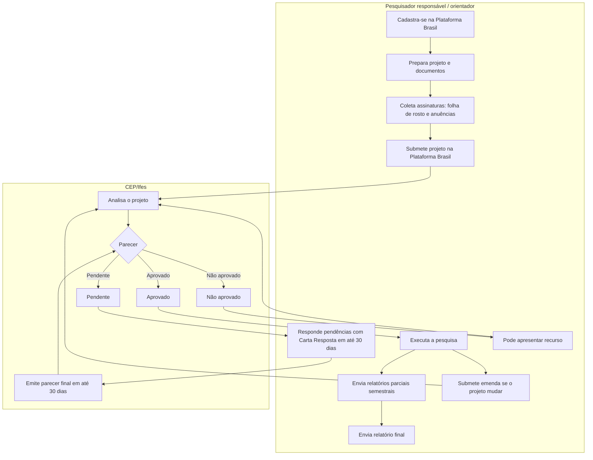

# Processo de submissão ao Comitê de Ética em Pesquisa (CEP/Ifes)

## Objetivo

Orientar pesquisadores e orientadores do campus na submissão de projetos de pesquisa com seres humanos ao Comitê de Ética em Pesquisa com Seres Humanos do Ifes (CEP/Ifes), desde o cadastro na Plataforma Brasil até o envio dos relatórios finais.

O CEP/Ifes é um colegiado independente e interdisciplinar, vinculado à Reitoria e registrado na CONEP desde 2009. Ele avalia, do ponto de vista ético, projetos que envolvam pessoas como participantes, conduzidos por pesquisadores ou estudantes do Ifes ou de instituições com acordo científico com o Ifes, e emite o Parecer Consubstanciado.

!!! warning "Regra principal"
    Nenhuma abordagem a participantes (entrevista, questionário, coleta de dados, gravação etc.) pode acontecer antes da aprovação do CEP. O cronograma do projeto precisa prever o início da coleta **depois** do parecer favorável.

## Quando usar este processo

Use este processo sempre que o projeto:

- Envolver pessoas como participantes, direta ou indiretamente (questionários, entrevistas, grupos focais, observação, testes com usuários, dados pessoais, imagem ou voz).
- For TCC, iniciação científica, especialização, mestrado ou doutorado com coleta junto a pessoas.
- For realizado em escolas, empresas, comunidades ou outros campi, exigindo carta de anuência.
- Envolver menores de idade ou pessoas legalmente incapazes (exige TALE).

Em caso de dúvida sobre a necessidade de submissão, consulte o CEP antes de iniciar a pesquisa.

## Visão geral do fluxo

## Fluxo do processo

| Etapa | Resultado esperado | Responsável principal |
| --- | --- | --- |
| 1. Cadastrar-se na Plataforma Brasil | Pesquisador com acesso à [Plataforma Brasil](http://aplicacao.saude.gov.br/plataformabrasil/login.jsf) | Pesquisador responsável |
| 2. Ler as normas | Projeto alinhado às Resoluções CNS 466/2012 e 510/2016 e à Norma Operacional 001/2013 | Pesquisador responsável |
| 3. Preparar projeto e documentos | Projeto detalhado, termos e instrumentos de coleta prontos, com cronograma coerente em todos os arquivos | Pesquisador responsável / orientador |
| 4. Coletar assinaturas | Folha de rosto e cartas de anuência assinadas e digitalizadas | Pesquisador + direção/instituições envolvidas |
| 5. Submeter na Plataforma Brasil | Projeto protocolado (submissão só pela plataforma) | Pesquisador responsável / orientador |
| 6. Análise ética | Parecer Consubstanciado: aprovado, pendente, não aprovado ou retirado | CEP/Ifes |
| 7. Atender pendências | Carta Resposta e documentos corrigidos enviados em até 30 dias | Pesquisador responsável |
| 8. Parecer final | Decisão emitida em até 30 dias após o atendimento da pendência | CEP/Ifes |
| 9. Executar e acompanhar | Relatórios parciais a cada semestre e relatório final ao término | Pesquisador responsável |

## Documentos necessários

| Documento | Finalidade | Observações |
| --- | --- | --- |
| Folha de Rosto | Identifica projeto, pesquisador e instituição proponente | Gerada pela Plataforma Brasil. Imprimir, assinar (pesquisador e responsável da instituição), digitalizar e anexar. Em Minter/Dinter, solicitar assinatura do Pró-Reitor de Pesquisa e Pós-Graduação por `prppg@ifes.edu.br`. |
| Carta de Anuência | Autoriza a pesquisa no local onde ocorrerá | Assinada e carimbada pelo responsável. Também da instituição coparticipante, se houver. Pesquisa em mais de um campus: assinatura do Pró-Reitor (PRPPG), a partir do [modelo](https://www.ifes.edu.br/images/stories/files/cep/carta-de-anuencia.doc). |
| TCLE | Termo de Consentimento Livre e Esclarecido | Seguir a Carta Circular 51/CONEP. |
| TALE | Termo de Assentimento Livre e Esclarecido | Obrigatório para menores de idade e legalmente incapazes (junto com o TCLE dos responsáveis). |
| Instrumento de coleta | Questionário, roteiro de entrevista ou modelo de coleta | Deve corresponder ao que será efetivamente aplicado. |
| Termo de Responsabilidade e Compromisso | Compromisso do pesquisador com as normas éticas | Assinado pelo pesquisador. [Modelo](https://www.ifes.edu.br/images/stories/files/cep/termo-responsabilidade-compromisso-pesquisador-responsavel.doc). |
| Projeto de pesquisa detalhado | Base da análise ética | Riscos, benefícios, cronograma e método explícitos. |
| Autorização de Uso de Imagem e Som | Necessária quando houver gravação de imagem, som ou voz | [Modelo .odt](https://www.ifes.edu.br/images/stories/-publicacoes/conselhos-comissoes/comite-etica-pesquisa-seres-humanos/2022/termo-autorizacao-utilizacao-imagem-som-voz.odt). |
| Carta Resposta | Resposta ponto a ponto às pendências do parecer | Só em caso de pendência. [Modelo .docx](https://www.ifes.edu.br/images/stories/-publicacoes/conselhos-comissoes/comite-etica-pesquisa-seres-humanos/2022/modelo-carta-resposta.docx). |

Os nomes dos arquivos anexados devem seguir a [orientação de nomenclatura do CEP](https://www.ifes.edu.br/images/stories/files/cep/orientacao_nomenclatura-arquivos-cep-dezembro-2018.pdf).

## Possíveis pareceres

| Parecer | Significado | O que fazer |
| --- | --- | --- |
| Aprovado | Projeto adequado para execução | Iniciar a coleta conforme o cronograma. |
| Pendente | Precisa de correção, revisão ou informação | Responder em até **30 dias**, com Carta Resposta e cronograma readequado. |
| Não aprovado | Óbices éticos graves, que não podem ser resolvidos por pendência | Cabe recurso ao CEP (manual "Submissão de recurso" da Central de Suporte). |
| Retirado | Cancelado a pedido do pesquisador ou por perda do prazo de pendência | Nova submissão, se o projeto continuar. |

O parecer completo fica na Plataforma Brasil: em "Documentos do projeto", abra a pasta "Parecer" e clique na lupa para abrir o PDF.

## Durante e depois da pesquisa

- **Relatórios parciais:** a cada semestre, pela Plataforma Brasil, via notificação.
- **Relatório final:** ao término do projeto.
- **Emenda:** obrigatória para mudanças no número de participantes, instituições coparticipantes, sigilo ou cronograma. No campo "justificativa da emenda", explicar o que mudou e por quê.
- **Relatório de suspensão:** quando houver risco de dano ao participante, superioridade clara de uma intervenção sobre outra ou impedimento operacional, com explicação detalhada.
- **Relatório de cancelamento:** por impedimento operacional ou desistência antes do início.

## Cuidados importantes

- Projetos de estudantes (graduação, especialização ou pós-graduação) devem ser submetidos pelo orientador ou ter o orientador na equipe cadastrada na Plataforma Brasil.
- Manter o cronograma igual em todos os documentos. Se houver pendência, atualizar as datas na nova submissão.
- Não escrever "não há riscos": toda pesquisa com seres humanos envolve algum risco. Descrever os riscos e como serão minimizados.
- Projetos de Ciências Sociais e Humanas seguem a Resolução 510/2016 e a Carta Circular 110/SEI/2017 no preenchimento da plataforma.
- Considerar o calendário de reuniões do CEP no planejamento. Em 2026, a última reunião é em **14/12/2026**, e a primeira de 2027 será em **15/02/2027**. Projetos com coleta no início do ano precisam ser submetidos com antecedência.
- Consultar os manuais da Central de Suporte da Plataforma Brasil ("Submeter projeto de pesquisa", "Enviar notificação", "Submissão de emenda", "Submissão de recurso").

## Normas e links úteis

- [Resolução CNS 466/2012](https://www.ifes.edu.br/images/stories/files/cep/resolucao-466-2012.pdf)
- [Resolução CNS 510/2016](https://www.ifes.edu.br/images/stories/files/cep/resolucao-510-2016.pdf)
- [Norma Operacional CNS 001/2013](https://www.ifes.edu.br/images/stories/files/cep/norma-operacional-001-2013.pdf)
- [Carta Circular 110/SEI/2017](https://www.ifes.edu.br/images/stories/files/cep/carta-circular-110-sei-2017.pdf)
- [Carta Circular 51/CONEP (TCLE)](https://www.ifes.edu.br/images/stories/files/cep/carta-circular-51-conep.pdf)
- [Calendário de reuniões do CEP](https://www.ifes.edu.br/conselhos-comissoes/comite-de-etica-em-pesquisa-do-ifes?start=2)
- [Orientações básicas do CEP/Ifes](https://www.ifes.edu.br/conselhos-comissoes/comite-de-etica-em-pesquisa-do-ifes?start=4)
- [Plataforma Brasil](http://aplicacao.saude.gov.br/plataformabrasil/login.jsf)

## Contato do CEP/Ifes

- **E-mail:** `etica.pesquisa@ifes.edu.br` e `secretaria.cep@ifes.edu.br`
- **Telefone:** (27) 92001-6011 e (27) 3357-7518
- **Endereço:** Av. Rio Branco, nº 50, Santa Lúcia, Vitória/ES, CEP 29056-255
- **Atendimento:** segunda a sexta, das 8h às 12h

## Checklist

- [ ] O pesquisador está cadastrado na Plataforma Brasil.
- [ ] O orientador é o submissor ou está na equipe do projeto (projetos de estudantes).
- [ ] O cronograma prevê a coleta só depois da aprovação e está igual em todos os documentos.
- [ ] Os riscos e as formas de minimizá-los estão descritos.
- [ ] A folha de rosto foi assinada e anexada.
- [ ] As cartas de anuência foram assinadas e anexadas.
- [ ] O TCLE foi anexado (e o TALE, se houver menores ou incapazes).
- [ ] O instrumento de coleta foi anexado.
- [ ] O Termo de Responsabilidade e Compromisso foi assinado e anexado.
- [ ] A autorização de uso de imagem e som foi anexada, se houver gravação.
- [ ] Os arquivos seguem a orientação de nomenclatura.
- [ ] O parecer foi acompanhado na Plataforma Brasil.
- [ ] As pendências, se houver, foram respondidas em até 30 dias.
- [ ] Os relatórios parciais e o relatório final foram enviados.

---

*Fonte: página do [Comitê de Ética em Pesquisa do Ifes](https://www.ifes.edu.br/conselhos-comissoes/comite-de-etica-em-pesquisa-do-ifes?start=4), consultada em 10/11/2026.*
